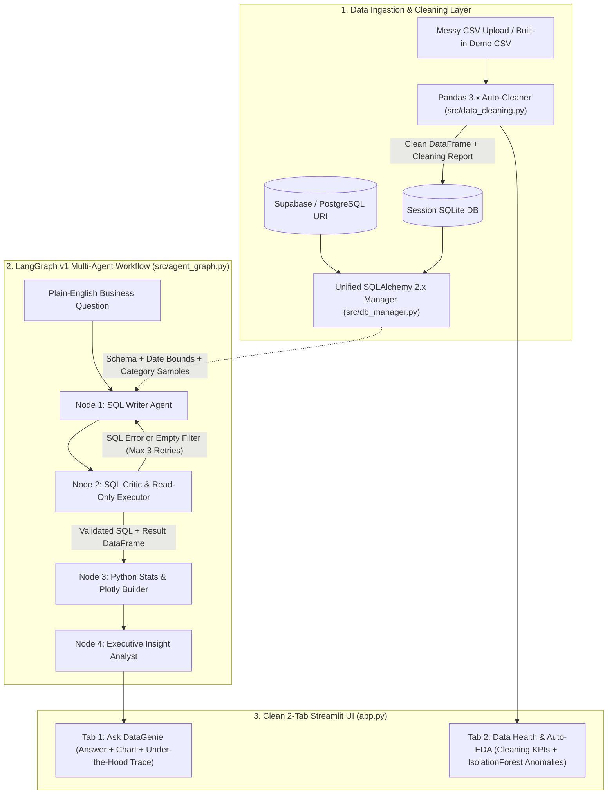

# 🧞 DataGenie — Autonomous BI & Data Analyst Agent

**DataGenie** is an interactive Business Intelligence & Data Analyst web application where anyone can ask complex business questions in plain English (e.g., *"Why did revenue drop in the North region last month?"*) against a **1-Click Demo Dataset**, a **messy uploaded CSV**, or a live **Supabase / PostgreSQL** database.

Designed to be **calm and effortless for business users** while showcasing **production-grade AI & Data Science engineering** under the hood:
- **Zero-Friction Conversational BI**: Plain-English executive answers paired with interactive dark-mode **Plotly** visualizations, while SQL queries, fetched tables, Python statistical checks, and agent steps stay neatly tucked inside an *"Under the Hood"* expander.
- **Self-Correcting 4-Node LangGraph v1 Pipeline**: Powered by **Groq** (`llama-3.3-70b-versatile`, `llama-4-scout`, `gpt-oss-20b`), featuring a `SQL Writer <-> SQL Critic` validation/retry loop (up to 3 self-corrections), deterministic Python statistics, structured chart synthesis, and executive insight generation.
- **Automated Data Cleaning & ML Anomaly Detection**: Programmatic **Pandas 3.x** pipeline that cleans duplicates, currency/percent strings (`"$1,420.50"`, `"15%"`), mixed date formats, and missing values with a transparent Before/After report, plus **Scikit-learn `IsolationForest`** + rolling Z-score time-series anomaly detection.
- **Strict Read-Only Database Layer**: Unified **SQLAlchemy 2.x** + **`psycopg` v3** manager blocking `DROP`, `DELETE`, `UPDATE`, `INSERT`, `ALTER`, and multi-statement SQL injection.

---

## 🏗️ Architecture



---

## 📂 Project Structure

```text
DataGenie/
├── app.py                      # Clean 2-tab Streamlit frontend
├── src/
│   ├── demo_data.py            # Deterministic messy Retail Sales CSV generator (~668 raw / 650 clean rows)
│   ├── data_cleaning.py        # Pandas 3.x automated cleaning pipeline + Before/After CleaningReport
│   ├── eda_engine.py           # Column profiler, Pearson heatmap & IsolationForest anomaly detector
│   ├── db_manager.py           # SQLAlchemy 2.x SQLite/Postgres manager + read-only SQL guardrails
│   ├── stats_analyzer.py       # Deterministic Python statistical checks + crash-free Plotly ChartSpec builder
│   └── agent_graph.py          # 4-node LangGraph v1 workflow orchestrated with ChatGroq
├── tests/
│   └── test_datagenie.py       # Automated pytest suite (cleaning, EDA, SQL safety, LangGraph retry, UI smoke test)
├── .streamlit/config.toml      # Dark theme & server settings
├── requirements.txt            # Python 3.12 verified dependencies
├── .python-version             # Pins Python 3.12 for Streamlit Community Cloud
├── Procfile                    # 1-line Heroku deployment launcher
└── Dockerfile                  # Lightweight python:3.12-slim container image
```

---

## 🚀 Quickstart (Local Setup)

### 1. Create a Virtual Environment & Install Dependencies

```powershell
python -m venv .venv
.\.venv\Scripts\activate
pip install -r requirements.txt
```

### 2. Configure Your Groq API Key

Copy `.env.example` to `.env` and add your free [Groq API Key](https://console.groq.com/keys) (or paste it directly in the app sidebar):

```powershell
copy .env.example .env
```

```env
GROQ_API_KEY=gsk_your_actual_groq_key_here
```

### 3. Launch DataGenie

```powershell
streamlit run app.py
```

### 4. Run Automated Tests

```powershell
pytest tests/test_datagenie.py -v
```

---

## ☁️ 1-Click Cloud Deployment

### Option A: Streamlit Community Cloud (Recommended — 100% Free)
1. Push this repository to GitHub (`.gitignore` automatically excludes `.env` and local `.db` files).
2. Go to [share.streamlit.io](https://share.streamlit.io/) and click **Create app**.
3. Select your GitHub repository, branch (`main`), and main file path: `app.py`.
4. Open **Advanced settings → Secrets** (`.python-version` automatically selects Python `3.12`) and paste:
   ```toml
   GROQ_API_KEY = "gsk_your_actual_groq_key_here"
   ```
5. Click **Deploy**!

### Option B: Heroku / Docker Container Hosting
- **Heroku**: Includes a ready `Procfile` (`web: streamlit run app.py --server.port=$PORT --server.address=0.0.0.0 --server.headless=true`). Set `GROQ_API_KEY` in Heroku Config Vars and deploy.
- **Docker (Railway / Azure Container Apps / Hugging Face Spaces)**:
  ```bash
  docker build -t datagenie .
  docker run -p 8501:8501 -e GROQ_API_KEY=gsk_your_key datagenie
  ```
