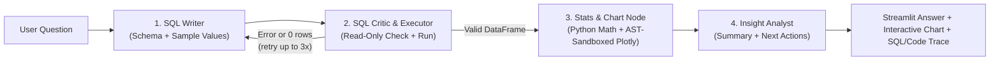

<div align="center">

# DataGenie

### Ask questions in plain English. Get verified SQL, real math, and interactive charts.

An open-source AI data analyst built with **Streamlit**, **LangGraph**, **Groq**, and **Python** that explores CSV files, messy spreadsheets, or live PostgreSQL / Supabase databases without letting the LLM guess numbers.

[](https://www.python.org/)
[](https://streamlit.io/)
[](https://github.com/langchain-ai/langgraph)
[](https://groq.com/)
[](#-testing)

[Features](#what-makes-datagenie-different) • [How It Works](#how-it-works) • [Project Structure](#project-structure) • [Quickstart](#quickstart) • [Deployment](#deployment)

</div>

---

## What It Does

Most AI database chatbots fail in two common ways: they write broken SQL on messy real-world data, or they let the language model guess sums, averages, and trends in text instead of computing them.

**DataGenie splits the job cleanly:**
- **The LLM handles language**: translating your question into SQL, writing custom Plotly chart scripts, and summarizing the findings in clear bullets.
- **SQL & Python handle the numbers**: cleaning raw data, running read-only SQL queries, computing totals/percentages/outliers deterministically, and validating both SQL and Python code before anything executes.

Every answer comes with an **"Under the hood"** panel showing the exact SQL query, raw result table, Python stats checks, and generated Plotly code so you never have to guess where a number came from.

---

## Key Features

- **Start Immediately — 3 Data Sources**
  - **Built-in Demo Dataset**: A ~668-row messy regional retail sales dataset (currencies with `$`, `%` strings, mixed date formats, duplicate rows, missing values, and a planted October revenue drop + daily anomalies to test root-cause analysis).
  - **CSV Upload**: Upload any CSV file. DataGenie automatically cleans it and loads it into a local session SQLite database.
  - **PostgreSQL / Supabase**: Connect directly with a read-only database URI.
- **Automatic Data Cleaning & Health Tab**
  - Standardizes headers to `snake_case`, parses currency/percentage strings into numbers, unifies mixed date formats (`YYYY-MM-DD`, `YYYY/MM/DD`, `DD-MM-YYYY`), trims extra spaces and inconsistent casing, removes exact duplicates, and imputes missing values cleanly (preserving binary `0/1` flags with modal fill rather than decimals).
  - Runs local **Auto-EDA**: column profiles, a numeric correlation heatmap, and daily anomaly detection using `IsolationForest` + rolling Z-scores.
- **Self-Correcting SQL Agent (Up to 3 Retries)**
  - If a generated query fails or returns zero rows, the **SQL Critic** captures the database error and sends it back to the **SQL Writer** to rewrite automatically.
- **Dual Security Sandboxes**
  - **Read-Only SQL Guard**: Token-aware validator blocks mutations (`DROP`, `DELETE`, `UPDATE`, `INSERT`, `ALTER`, `TRUNCATE`, stacked statements, and standalone `REPLACE INTO`), while still permitting safe read-only expressions like `SELECT REPLACE(...)` and quoted identifiers.
  - **AST Plotly Sandbox**: LLM-generated visualization code is parsed into a Python AST before running. Only approved charting/math modules (`plotly`, `pandas`, `numpy`, and `scipy` when installed) are allowed; file I/O, `eval`/`exec`, dunder attribute access, and unsupported libraries (`statsmodels` trendlines) are blocked. If generated code fails, DataGenie falls back cleanly to its deterministic chart builder.
- **Rich Chart Support**
  - Bar, grouped/stacked bar, line, area, pie/donut, scatter, bubble (`px.scatter` with size), box, violin (with embedded box plot), histogram, treemap, 2D heatmap, and funnel charts — including negation-aware fallback matching (e.g., *"as a line chart, avoiding area-chart styling"* renders a line chart, not an area chart).
- **Light & Dark Theme UI**
  - Adaptive Streamlit dashboard styling with KPI sparkline tiles, clear step-by-step trace pills, and switchable light/dark themes.

---

## How It Works

Each question flows through a 4-node **LangGraph** pipeline:



### Example Walkthrough (Demo Dataset)

1. **You ask:** *"Why did revenue drop in the North region last month?"*
2. **SQL Writer & Critic:** Inspects the `sales_data` table (`order_date`, `region`, `product_category`, `revenue`, `units_sold`, `shipping_delay_days`, etc.) and runs a validated read-only query comparing September vs October 2026 across regions and categories.
3. **Python Stats & Chart Node:** Calculates exact totals and month-over-month deltas (~32% North revenue drop in October 2026 from Electronics stockouts and ~9-day shipping delays) and renders a verified interactive Plotly chart.
4. **Insight Analyst:** Presents concise takeaways backed only by the computed figures, alongside the inspectable SQL query and table.

---

## What Makes DataGenie Different

| Area | DataGenie | Typical LLM Wrapper |
| :--- | :--- | :--- |
| **Math & Metrics** | Computed in Python (`pandas` / `numpy`) and SQL | Estimated in LLM text (prone to arithmetic mistakes) |
| **Broken SQL Handling** | Automatic error-feedback loop (up to 3 retries) | Fails immediately or prints raw database errors |
| **Messy CSVs** | Auto-cleans currencies, `%`, mixed dates, duplicates, and nulls | Crashes or treats `"$1,420.50"` as plain text |
| **SQL Safety** | Token/comment-aware read-only validator before execution | Basic keyword check or unguarded execution |
| **Chart Safety** | Static AST security inspection + deterministic chart fallback | Runs raw `exec()` or crashes on invalid columns |

---

## Project Structure

```text
DataGenie/
├── app.py                      # Streamlit entrypoint, tabs (Ask DataGenie & Data health), KPI tiles
├── src/
│   ├── agent_graph.py          # 4-node LangGraph workflow & Groq model connector
│   ├── data_cleaning.py        # Pandas cleaning pipeline & before/after CleaningReport
│   ├── db_manager.py           # SQLite/PostgreSQL manager + read-only SQL validator
│   ├── demo_data.py            # Built-in ~668-row messy retail dataset generator
│   ├── eda_engine.py           # Column profiler, correlation matrix & IsolationForest anomaly detector
│   ├── stats_analyzer.py       # Statistical checks, AST Plotly sandbox & fallback chart builder
│   └── ui.py                   # Custom CSS tokens, KPI computation & HTML trace components
├── tests/
│   └── test_datagenie.py       # Parameterized pytest suite (159 tests)
├── .streamlit/
│   └── config.toml             # Streamlit server settings and light/dark themes
├── Dockerfile                  # python:3.12-slim container setup
├── Procfile                    # Process config for PaaS hosting
├── requirements.txt            # Python 3.12 dependencies
└── .env.example                # Environment variable template
```

---

## Supported Groq Models

In the sidebar, DataGenie checks your Groq API key live and lets you switch between:
- `openai/gpt-oss-120b`
- `qwen/qwen3.8-27b`
- `openai/gpt-oss-20b`

---

## Quickstart

### Prerequisites
- **Python 3.12**
- A free [Groq API Key](https://console.groq.com/keys)

### 1. Clone and Install

**Windows (PowerShell):**
```powershell
git clone https://github.com/ahsankamran613-svg/DataGenie.git
cd DataGenie
py -3.12 -m venv .venv
.\.venv\Scripts\Activate.ps1
pip install -r requirements.txt
```

**macOS / Linux:**
```bash
git clone https://github.com/ahsankamran613-svg/DataGenie.git
cd DataGenie
python3.12 -m venv .venv
source .venv/bin/activate
pip install -r requirements.txt
```

### 2. Add Your Groq API Key

Copy `.env.example` to `.env`:

```bash
cp .env.example .env
```

Set `GROQ_API_KEY` inside `.env` *(optional — you can also paste your key directly in the app sidebar)*:

```env
GROQ_API_KEY=gsk_your_groq_api_key_here
```

### 3. Start the App

```bash
streamlit run app.py
```

Open `http://localhost:8501` in your browser.

---

## Testing

DataGenie ships with **159 automated tests** covering data cleaning, SQL read-only guardrails, column type inference, AST sandbox safety, chart fallback + negation handling, mocked LangGraph retry loops, and headless Streamlit smoke checks:

```bash
python -m pytest tests/test_datagenie.py -v
```

---

## Deployment

### Streamlit Community Cloud
1. Push your fork to GitHub.
2. Go to [share.streamlit.io](https://share.streamlit.io/), select your repo and `app.py`.
3. Under **Settings → Secrets**, add:
   ```toml
   GROQ_API_KEY = "gsk_your_actual_groq_key_here"
   ```
4. Deploy (`.python-version` sets Python 3.12 automatically).

### Docker
```bash
docker build -t datagenie:latest .
docker run -d -p 8501:8501 -e GROQ_API_KEY=gsk_your_key_here --name datagenie datagenie:latest
```

### PaaS (`Procfile`)
```text
web: streamlit run app.py --server.port=$PORT --server.address=0.0.0.0 --server.headless=true
```
Set `GROQ_API_KEY` in your host's environment variables and deploy.
