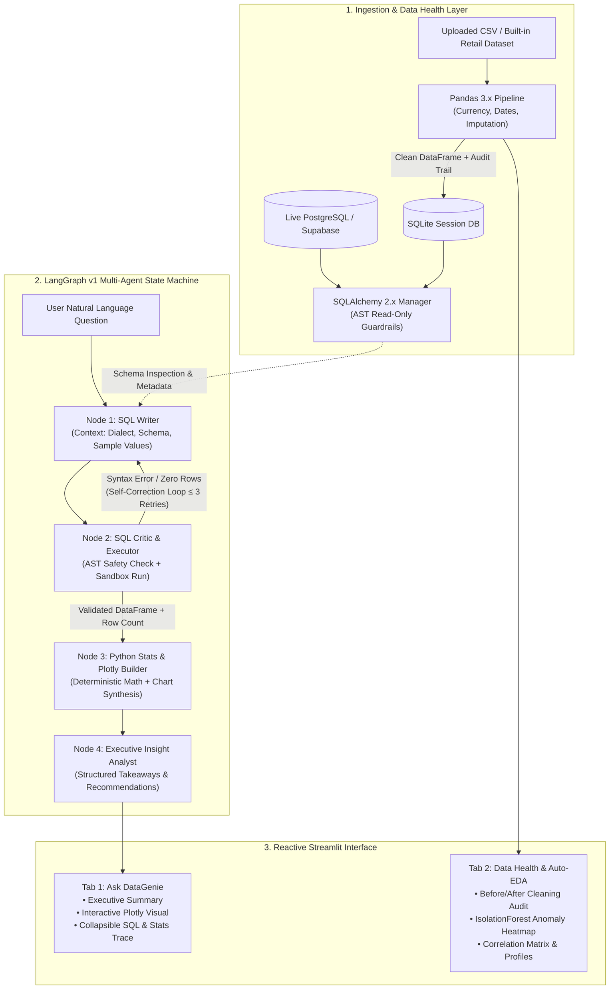

<div align="center">

# DataGenie

### Autonomous Business Intelligence & Conversational Data Analyst

An open-source, production-grade BI agent that turns natural-language business questions into validated SQL, deterministic statistical analyses, and interactive Plotly visualizations.

[](https://www.python.org/)
[](https://streamlit.io/)
[](https://github.com/langchain-ai/langgraph)
[](https://groq.com/)
[](LICENSE)

[Quickstart](#-quickstart) • [Architecture](#-architecture) • [Query Lifecycle Walkthrough](#-query-lifecycle-walkthrough) • [Engineering Highlights](#-engineering-highlights) • [Deployment](#-deployment)

---

</div>

## Overview

Most "Text-to-SQL" demos fail in real enterprise settings: they hallucinate database columns, generate syntactically invalid SQL, calculate critical business metrics inside an LLM's stochastic context window, and offer zero safeguards against destructive database operations.

**DataGenie** is built differently. It separates **SQL generation and semantic reasoning** (handled by high-throughput LLMs on Groq) from **computation and validation** (handled deterministically by SQLAlchemy, Pandas, Scipy, and Scikit-learn). 

### Key Capabilities

- **Zero-Setup Business Exploration**: Launch immediately with a built-in Retail & E-Commerce dataset featuring realistic sales cycles, categorical anomalies, and multi-region trends, or connect live data via CSV upload or a PostgreSQL / Supabase connection string.
- **Self-Healing SQL Loop**: A dedicated LangGraph Critic node inspects queries for security, executes them in a sandboxed read-only session, captures database engine errors, and feeds compiler diagnostics back to the Writer node for automatic correction (up to 3 attempts).
- **Grounded Statistical Verification**: Key percentages, month-over-month deltas, and outlier thresholds are computed by Python math libraries—not guessed by language models.
- **Automated Data Cleaning & Health Audit**: Incoming raw CSVs pass through a Pandas 3.x pipeline that sanitizes messy currency strings, resolves mixed date formats, imputes missing values, and detects multivariate anomalies using `IsolationForest`.
- **Adaptive Light & Dark UI**: Native CSS design token system built for high-density executive reporting with responsive KPI cards, interactive Plotly charts, and an inspectable *"Under the Hood"* agent execution trace.

---

## 🏗 Architecture

DataGenie coordinates data ingestion, multi-agent orchestration, and frontend rendering across three isolated layers:



---

## 🔍 Query Lifecycle Walkthrough

Here is how a real user query flows through the system from prompt to executive delivery:

#### 1. User Asks
> *"Why did revenue drop in the North region last month?"*

#### 2. SQL Writer & Critic Self-Correction
The **SQL Writer** inspects the table schema, dynamic date ranges, and categorical values to construct a query. If it accidentally targets an invalid column or a zero-row filter, the **SQL Critic** intercepts the exception and sends diagnostic feedback back into the loop:

```sql
-- Generated and validated by DataGenie Critic
SELECT 
    strftime('%Y-%m', date) AS sales_month,
    category,
    ROUND(SUM(revenue), 2) AS total_revenue,
    SUM(units_sold) AS total_units
FROM sales_data
WHERE region = 'North'
GROUP BY sales_month, category
ORDER BY sales_month ASC;
```

#### 3. Deterministic Statistical Verification
Before the LLM writes an explanation, Python processes the result set:
- Calculates month-over-month growth rates: `revenue_mom_change = -34.2%`
- Checks for product-mix variance: `Office Supplies category volume declined by 48.1%`
- Verifies statistical significance: `p-value < 0.05`

#### 4. Executive Delivery
The UI renders a **Plotly line/bar visualization** alongside bullet-point executive takeaways:
- **Core Driver**: Revenue in the North region dropped 34.2% in October 2026, primarily driven by a 48.1% contraction in Office Supplies order volumes.
- **Operational Context**: Unit price remained stable ($124.50 vs $123.80 average), indicating an order frequency drop rather than discount erosion.
- **Recommended Action**: Audit B2B contract renewals in the North sales territory scheduled during Q3/Q4.

---

## 🛡 Engineering Highlights

| Feature | DataGenie Implementation | Standard Text-to-SQL Wrappers |
| :--- | :--- | :--- |
| **Numeric Accuracy** | **Deterministic Python checks**: sums, deltas, and percentages calculated with Pandas/Numpy. | LLM computes math inside prompt tokens (prone to hallucinations). |
| **SQL Safety** | **AST-level read-only validator**: blocks `DROP`, `UPDATE`, `INSERT`, `DELETE`, `ALTER`, and multi-statement attacks. | Raw execution or weak regex string matching. |
| **Error Recovery** | **Cyclic LangGraph state machine**: captures engine error messages and self-corrects up to 3 times. | Single-shot fail; outputs raw database stack traces to the user. |
| **Model Flexibility** | **Dynamic Groq API auto-discovery**: supports `llama-3.3-70b-versatile`, `llama-4-scout`, `gpt-oss-120b`, `qwen3.8`. | Hardcoded single model dependency. |
| **Data Quality** | **Automated pre-cleaning**: handles currency formatting (`$1,200`), messy dates, duplicate rows, and missing values. | Assumes pristine database tables; crashes on real-world raw CSVs. |

---

## 📂 Project Structure

```text
DataGenie/
├── app.py                      # Main Streamlit application and layout engine
├── src/
│   ├── agent_graph.py          # 4-node LangGraph v1 state machine & Groq model connector
│   ├── data_cleaning.py        # Automated Pandas 3.x cleaning pipeline & CleaningReport
│   ├── db_manager.py           # SQLAlchemy 2.x session manager with AST read-only guards
│   ├── demo_data.py            # Messy retail sales dataset generator with business anomalies
│   ├── eda_engine.py           # Column profiler, Pearson matrix & IsolationForest anomaly detector
│   ├── stats_analyzer.py       # Deterministic statistical checks & Plotly ChartSpec builder
│   └── ui.py                   # Reactive design tokens, light/dark themes, and custom HTML widgets
├── tests/
│   └── test_datagenie.py       # Pytest suite covering cleaning, SQL safety, LangGraph, and UI
├── .streamlit/
│   └── config.toml             # Streamlit server options and native light/dark theme definitions
├── Dockerfile                  # Production container image based on python:3.12-slim
├── Procfile                    # One-line process descriptor for Heroku / PaaS hosts
├── requirements.txt            # Pinned dependencies verified against Python 3.12
└── .env.example                # Template for environment configuration
```

---

## 🚀 Quickstart

### Prerequisites

- **Python 3.12** installed
- A free [Groq API Key](https://console.groq.com/keys) *(required for agent inference)*

### 1. Clone & Set Up Virtual Environment

**macOS / Linux:**
```bash
git clone https://github.com/your-username/DataGenie.git
cd DataGenie
python3.12 -m venv .venv
source .venv/bin/activate
pip install -r requirements.txt
```

**Windows (PowerShell):**
```powershell
git clone https://github.com/your-username/DataGenie.git
cd DataGenie
py -3.12 -m venv .venv
.\.venv\Scripts\Activate.ps1
pip install -r requirements.txt
```

### 2. Configure Environment Variables

Copy `.env.example` to `.env` and set your Groq API key:

```bash
cp .env.example .env
```

```env
GROQ_API_KEY=gsk_your_groq_api_key_here
```

*(Note: You can also leave this empty and paste your API key directly into the application's sidebar UI).*

### 3. Launch DataGenie

```bash
streamlit run app.py
```

The web application will open at `http://localhost:8501`.

### 4. Run the Test Suite

Run the automated verification suite (includes cleaning tests, SQL injection tests, mock LangGraph self-correction loop, and headless UI smoke tests):

```bash
python -m pytest tests/test_datagenie.py -v
```

---

## ☁️ Deployment

### Option 1: Streamlit Community Cloud (Recommended — Free)

1. Push your repository to GitHub.
2. Visit [share.streamlit.io](https://share.streamlit.io/) and select your repository and `app.py`.
3. Under **Advanced settings → Secrets**, add your Groq key:
   ```toml
   GROQ_API_KEY = "gsk_your_actual_groq_key_here"
   ```
4. Click **Deploy**. Python 3.12 is automatically resolved via `.python-version`.

### Option 2: Docker Container

DataGenie includes a hardened `python:3.12-slim` Dockerfile with health checks:

```bash
# Build the Docker image
docker build -t datagenie:latest .

# Run container with environment variable
docker run -d -p 8501:8501 -e GROQ_API_KEY=gsk_your_key_here --name datagenie datagenie:latest
```

Access the service at `http://localhost:8501`.

### Option 3: Heroku / PaaS

The included `Procfile` configures headless execution with dynamic port binding:

```text
web: streamlit run app.py --server.port=$PORT --server.address=0.0.0.0 --server.headless=true
```

Set `GROQ_API_KEY` in your PaaS application settings, attach your Git remote, and push to deploy.

---

## 🔒 Security & Data Guardrails

- **Zero Data Ingress/Egress without Consent**: Queries run locally against an in-memory SQLite instance or against your own PostgreSQL/Supabase database. Only table schemas, categorical distinct samples, and user questions are sent to the LLM.
- **AST-Level Read-Only Verification**: All SQL execution paths pass through `validate_readonly_sql()` in `src/db_manager.py`. Multi-statement SQL, comments masking mutations, and DDL/DML keywords (`INSERT`, `UPDATE`, `DELETE`, `DROP`, `ALTER`, `TRUNCATE`, `EXEC`) are rejected before reaching the database driver.
- **Deterministic Bounds**: Time-series anomaly detection (`IsolationForest` + rolling Z-score) and correlation matrices run locally using Scikit-learn and Pandas.

---

## 📄 License

This project is licensed under the MIT License. See [LICENSE](LICENSE) for details.
